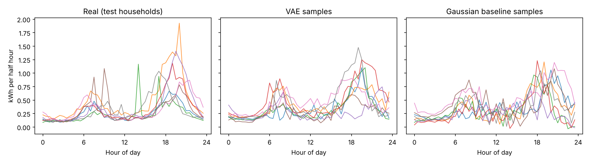
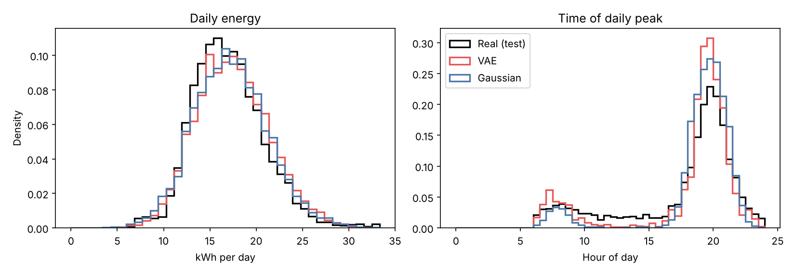

# Variational Autoencoder for Synthetic Household Load Profiles

A variational autoencoder (VAE) written **from first principles in NumPy**: hand-derived backpropagation, a numerical gradient check and an Adam optimiser, with no deep-learning framework. It is trained to generate realistic daily electricity load profiles (48 half-hourly readings per day) and evaluated against a simple statistical baseline on households it has never seen.

> **About this repository.** This is a 2026 reimplementation of a project from my M.Tech work at IIT Hyderabad. The original smart-meter data cannot be shared, so this version uses a **synthetic dataset** generated by `src/vaeload/data.py`. The code was written with AI assistance; I have reviewed it and can explain every part of it.



## Why this matters

Smart-meter data is often private, so researchers and utilities can't share it. A generative model that captures the *statistics* of real load profiles (daily energy, peak timing, correlations across the day) can produce shareable synthetic data for planning studies, forecasting benchmarks and demand-response design.

## Results (test households, never seen in training)

| Metric (lower is better unless noted) | Real data from other households *(reference)* | **VAE** | Gaussian baseline |
|---|---:|---:|---:|
| Daily energy: KS statistic | 0.035 | 0.065 | **0.050** |
| **Time of daily peak: KS statistic** | 0.024 | **0.102** | 0.175 |
| Mean profile RMSE (kWh) | 0.008 | 0.011 | **0.007** |
| Correlation matrix MAE | 0.034 | 0.079 | **0.045** |
| MMD (overall distribution distance) | 0.0045 | 0.0095 | **0.0047** |
| Negative (impossible) values | 0% | **0.09%** | 0.90% |

**What this shows, honestly:**

- **The VAE captures *when* the peak happens much better** (KS 0.10 vs 0.18). Real profiles have a bimodal peak-time distribution, morning or evening, and a single Gaussian cannot represent that. This nonlinear structure is where a VAE should help.
- **The Gaussian baseline matches the overall statistics better** (MMD, correlations, mean profile). For 48-dimensional data with smooth daily shapes, a well-fitted multivariate Gaussian is a strong baseline, and many papers skip it.
- **The Gaussian baseline produces ten times more negative loads**, which are physically impossible.
- KS *p-values* are not reported as evidence. With 6,000 test profiles, the KS test rejects even real-vs-real comparisons (p = 0.001 in the reference column), so the KS *statistic* is the meaningful number.

**Conclusion:** a VAE is worth using when the shape and timing of demand matter (for example in demand-response studies). If only aggregate statistics matter, a Gaussian model is simpler and at least as good. Better architectures (convolutional or conditional VAEs) are an obvious next step.



## Method

**Data.** 500 synthetic households × 60 days = 30,000 daily profiles. Each household has a persistent base load, morning and evening peak times and sizes, and heating sensitivity. Days add weekday/weekend behaviour, random appliance spikes and noise (see `data.py`). The split is **by household**, 60% train / 20% validation / 20% test.

**Preprocessing.** `log(1 + x)`, then standardise each half-hour. Working in log space keeps generated loads positive in most cases.

**Model.** Encoder 48 → 64 (tanh) → latent mean and log-variance. Decoder latent → 64 (tanh) → 48. The loss is a Gaussian reconstruction term with fixed noise variance *s²* plus the KL divergence to N(0, I). All gradients are derived by hand in `vae.py` (`VAE.backward`).

**Gradient check.** The analytic gradients agree with central finite differences to a relative error of about 1e-8 (`tests/test_vae.py`, and logged in `results/tables/run_info.json`).

**Model selection.** Latent size ∈ {4, 8, 16} × *s²* ∈ {0.05, 0.1, 0.2}, chosen by MMD on **validation** households only (`results/tables/model_selection_validation.csv`). The selected model has latent size 16 and *s²* = 0.05. The test set is used once, at the end.

**Baseline.** A multivariate Gaussian fitted to the same transformed training data.

**Reference.** Real profiles from *other* households, which shows the best score any generator could realistically reach.

## Repository structure

```
├── src/vaeload/
│   ├── data.py        # synthetic profile generator and household split
│   ├── vae.py         # VAE forward/backward, Adam, gradient check, training loop
│   └── evaluate.py    # transforms, Gaussian baseline, fidelity metrics
├── scripts/run_experiment.py   # reproduces every table and figure
├── results/figures/ and results/tables/
└── tests/test_vae.py
```

## How to run

```bash
pip install -r requirements.txt
python scripts/run_experiment.py   # about 2 minutes on a laptop CPU
pytest
```

## Limitations

- The data is synthetic, so the results show the method works on data with known structure. They are not a claim about any real population.
- The fully connected architecture ignores the time ordering of the 48 readings. A 1-D convolutional encoder and decoder would likely capture peak shapes better.
- The model is unconditional: it cannot be asked for "a weekday profile in winter". A conditional VAE would allow that.

## License

MIT
